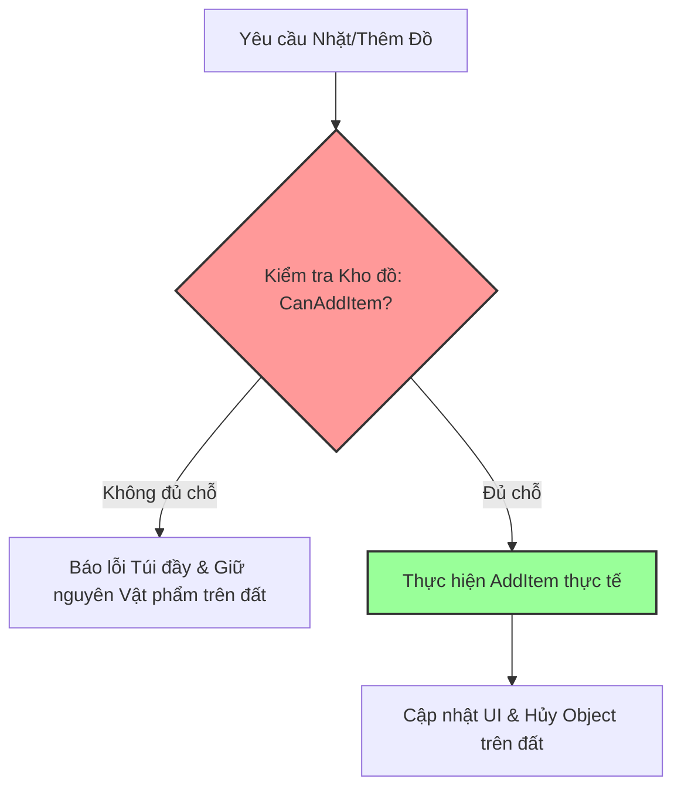

# BÁO CÁO PHÂN TÍCH CODEBASE & ĐỀ XUẤT TỐI ƯU HÓA

> [!NOTE]
> Báo cáo này được thực hiện bởi **Senior Game Architect** nhằm hỗ trợ sinh viên Đại học Nha Trang hoàn thiện đồ án tốt nghiệp khóa 2026. Nội dung tập trung vào việc phát hiện các lỗi logic (Bugs), xung đột hệ thống (Conflicts) và đề xuất các giải pháp Clean Code & SOLID.

---

## 1. TỔNG QUAN HỆ THỐNG HIỆN TẠI
Hệ thống hiện tại được thiết kế theo mô hình 3 lớp (**Data - Logic - UI**):
- **Data (Dữ liệu)**: `ItemData.cs` (ScriptableObject) và `ItemSlot.cs` (Data Model) đại diện cho vật phẩm.
- **Logic (Điều phối)**: `InventoryManager.cs` điều khiển dữ liệu kho đồ; `InputManager.cs` quản lý Input Action; `PlayerSelector.cs` & `PlayerMovement.cs` quản lý hành vi người chơi.
- **UI (Giao diện)**: `InventoryUI.cs` và `InventorySlotUI.cs` cập nhật hiển thị kho đồ.

Mặc dù cấu trúc thư mục rất chuẩn chỉnh và gọn gàng, hệ thống đang tồn tại **4 lỗi nghiêm trọng** (gồm lỗi logic giao dịch, xung đột điều khiển phần cứng và lỗi trải nghiệm người dùng).

---

## 2. CHI TIẾT CÁC LỖ HỔNG & CONFLICTS PHÁT HIỆN

### 🔴 Lỗi 1: Vi phạm Tính Toàn Vẹn Giao Dịch (Transactional Integrity)
* **Vị trí**: [InventoryManager.cs](file:///d:/Robotics/Assets/_Scripts/_Managers/InventoryManager.cs#L62-L126) kết hợp với [ItemPickup.cs](file:///d:/Robotics/Assets/_Scripts/_Controllers/Inventory/ItemPickup.cs#L103-L115).
* **Mô tả chi tiết**: 
  Khi người chơi nhặt một xấp vật phẩm lớn (ví dụ: Sắt x150) hoặc nhiều loại vật phẩm cùng lúc khi túi đồ sắp đầy:
  1. Hàm `AddItem` duyệt và nhét dần vật phẩm vào túi đồ cho đến khi đầy (`slots.Count == maxSlots`).
  2. Khi đầy, hàm in ra `Debug.LogWarning("Túi đồ đã đầy!")` và **trả về `false`**.
  3. Ở phía `ItemPickup.cs`, do nhận kết quả `success = false`, nó hiểu là **không nhặt được gì**, tuy nhiên thực tế một lượng vật phẩm lớn (như Sắt x99 đầu tiên) đã được đưa vào kho đồ của người chơi thành công.
  4. Nguy hiểm hơn, nếu trong pool nhặt có nhiều vật phẩm và chỉ cần một vật phẩm thêm thành công (`anySuccess == true`), GameObject `ItemPickup` trên thế giới sẽ bị **hủy bỏ (`Destroy`)**. Điều này dẫn đến việc người chơi bị mất các vật phẩm còn lại trong túi đồ nhặt mà không thể nhặt lại, hoặc tạo ra lỗi nhân bản vật phẩm (exploit) nếu logic xử lý không đồng bộ.
* **Hệ quả**: Lỗi logic giao dịch nghiêm trọng, gây mất vật phẩm hoặc bug nhân bản vật phẩm (Exploit).

### 🔴 Lỗi 2: Xung Đột Quản Lý Con Trỏ Chuột (Cursor Lock State Conflict)
* **Vị trí**: [CameraController.cs](file:///d:/Robotics/Assets/_Scripts/_Controllers/CameraController.cs#L20-L45) và [InventoryUI.cs](file:///d:/Robotics/Assets/_Scripts/_Controllers/Inventory/InventoryUI.cs#L110-L137).
* **Mô tả chi tiết**:
  - `InventoryUI` mở khóa chuột bằng cách gọi `InputManager.Instance.SetCursorState(false)` khi mở túi đồ để người chơi nhấn chọn các slot.
  - Tuy nhiên, trong `CameraController.cs`, hàm `Update` liên tục lắng nghe click chuột trái:
    ```csharp
    if (Mouse.current != null && Mouse.current.leftButton.wasPressedThisFrame && !isCursorLocked)
    {
        SetCursorState(true); // Tự động khóa chuột lại!
    }
    ```
  - Khi người chơi mở túi đồ và click chuột trái để chọn vật phẩm, `CameraController` ngay lập tức bắt được sự kiện này và khóa/ẩn chuột lại. Người chơi sẽ bị mất con trỏ chuột và không thể tương tác với UI nữa.
* **Nguyên nhân**: Vi phạm **Single Responsibility Principle (SRP)**. Trạng thái con trỏ chuột (Cursor State) bị quản lý phân tán ở nhiều lớp khác nhau (`InputManager`, `CameraController`, `InventoryUI`) thay vì quy về một mối quản lý tập trung.

### 🟡 Lỗi 3: Không Khóa Di Chuyển & Tương Tác Khi Đang Mở UI
* **Vị trí**: [PlayerMovement.cs](file:///d:/Robotics/Assets/_Scripts/_Controllers/Player/PlayerMovement.cs#L49-L60) và [PlayerSelector.cs](file:///d:/Robotics/Assets/_Scripts/_Controllers/Player/PlayerSelector.cs#L34-L38).
* **Mô tả chi tiết**:
  - Khi túi đồ đang mở (`InventoryManager.Instance.IsOpen == true`), người chơi vẫn có thể nhấn các phím di chuyển WASD khiến nhân vật chạy vòng quanh phía sau UI.
  - Đồng thời, `PlayerSelector` vẫn tiếp tục quét vật lý xung quanh và cho phép bấm phím tương tác `[E]` (nhặt đồ, mở cửa, sử dụng bàn chế tạo) xuyên qua giao diện đang hiển thị.
* **Hệ quả**: Trải nghiệm người dùng (UX) rất tệ, dễ phát sinh lỗi đồng bộ khi người chơi tương tác với vật thể khác trong khi UI cũ chưa đóng.

### 🟡 Lỗi 4: Lỗi Null Reference Tiềm Ẩn & Liên Kết Cứng (Hard Dependency)
* **Vị trí**: [PlayerMovement.cs](file:///d:/Robotics/Assets/_Scripts/_Controllers/Player/PlayerMovement.cs#L8) và [PlayerSelector.cs](file:///d:/Robotics/Assets/_Scripts/_Controllers/Player/PlayerSelector.cs#L20).
* **Mô tả chi tiết**:
  - Cả hai script trên đều sử dụng trường SerializeField để liên kết với `InputManager`. Nếu lập trình viên quên kéo thả `InputManager` trong Unity Editor, trò chơi sẽ crash ngay lập tức vì `NullReferenceException` ở frame đầu tiên.
  - Trong khi đó, `InputManager` đã được thiết kế dưới dạng **Singleton**. Việc vừa dùng Singleton vừa yêu cầu kéo thả thủ công làm mất đi lợi thế của Singleton và tăng khả năng xảy ra lỗi do quên cấu hình Editor.

---

## 3. ĐỀ XUẤT GIẢI PHÁP TÁI CẤU TRÚC (REFACTORING PLAN)

Để giải quyết triệt để các vấn đề trên và đảm bảo hệ thống vận hành mượt mà cho đồ án tốt nghiệp, chúng ta sẽ thực hiện 4 bước tối ưu hóa sau:



### Giải pháp 1: Triển khai Kiểm Tra Sức Chứa Trước (Dry-Run Check)
Thêm hàm kiểm tra `CanAddItem` vào `InventoryManager` để tính toán xem túi đồ có đủ chỗ chứa toàn bộ số lượng vật phẩm hay không trước khi thực sự thêm vào:

```csharp
// Thêm vào InventoryManager.cs
public bool CanAddItem(ItemData itemToAdd, int amount)
{
    if (itemToAdd == null || amount <= 0) return false;
    
    int freeSpace = 0;
    if (itemToAdd.isStackable)
    {
        // Tính dung lượng còn trống ở các ô hiện tại
        foreach (var slot in slots)
        {
            if (slot.item == itemToAdd && slot.quantity < itemToAdd.maxStackSize)
            {
                freeSpace += (itemToAdd.maxStackSize - slot.quantity);
            }
        }
    }
    
    // Tính số lượng ô trống hoàn toàn
    int emptySlotsCount = maxSlots - slots.Count;
    freeSpace += emptySlotsCount * (itemToAdd.isStackable ? itemToAdd.maxStackSize : 1);
    
    return freeSpace >= amount;
}
```
*Khi nhặt đồ (`ItemPickup.cs`), ta chỉ cần check:*
`if (InventoryManager.Instance.CanAddItem(item, amount)) { InventoryManager.Instance.AddItem(item, amount); }`

---

### Giải pháp 2: Quản Lý Trạng Tính Con Trỏ Chuột Tập Trung
1. Loại bỏ logic lắng nghe click chuột trái để khóa chuột trong `CameraController.cs`.
2. Đưa toàn bộ quyền kiểm soát chuột về một hàm tập trung trong `InputManager.cs` hoặc quản lý thông qua Trạng thái Game (Gameplay vs UI).
3. `CameraController` chỉ được phép xoay camera nếu chuột đang ở trạng thái khóa.

---

### Giải pháp 3: Khóa Di Chuyển và Tương Tác Khi Mở UI
- Trong `PlayerMovement.cs` và `PlayerSelector.cs`, thêm kiểm tra trạng thái mở của túi đồ hoặc UI:
```csharp
private void Update()
{
    // Nếu túi đồ đang mở, dừng mọi logic di chuyển/tương tác vật lý
    if (InventoryManager.Instance != null && InventoryManager.Instance.IsOpen)
    {
        // Reset velocity về trạng thái đứng yên nếu cần
        return;
    }
    
    // Logic di chuyển/tương tác bình thường...
}
```

---

### Giải pháp 4: Tự Động Kết Nối Singleton (Auto-wiring)
Trong `Awake()` hoặc `Start()` của `PlayerMovement` và `PlayerSelector`, nếu biến `inputManager` chưa được gán, ta tự động gán thông qua Singleton:
```csharp
private void Awake()
{
    if (inputManager == null)
    {
        inputManager = InputManager.Instance;
        if (inputManager == null)
        {
            inputManager = FindAnyObjectByType<InputManager>();
        }
    }
}
```

---

## 4. KẾ HOẠCH THỰC HIỆN SPRINT (SPRINT PLAN)

| Bước | Phân Loại | Công Việc Chi Tiết | File Ảnh Hưởng |
| :--- | :--- | :--- | :--- |
| **Bước 1** | Tái cấu trúc logic | Thêm hàm `CanAddItem` vào `InventoryManager` và cập nhật logic nhặt đồ tại `ItemPickup` để đảm bảo tính toàn vẹn. | `InventoryManager.cs`, `ItemPickup.cs` |
| **Bước 2** | Đồng bộ Cursor | Loại bỏ logic click khóa chuột trong `CameraController` và chuyển quyền điều phối con trỏ chuột sang GameManager/InputManager. | `CameraController.cs`, `InputManager.cs` |
| **Bước 3** | Khóa Input | Cập nhật `PlayerMovement` và `PlayerSelector` kiểm tra trạng thái `InventoryManager.Instance.IsOpen` để dừng di chuyển/tương tác khi UI mở. | `PlayerMovement.cs`, `PlayerSelector.cs` |
| **Bước 4** | Khắc phục Null | Cải tiến cơ chế tự động gán references cho `InputManager` trong các controller. | `PlayerMovement.cs`, `PlayerSelector.cs` |
