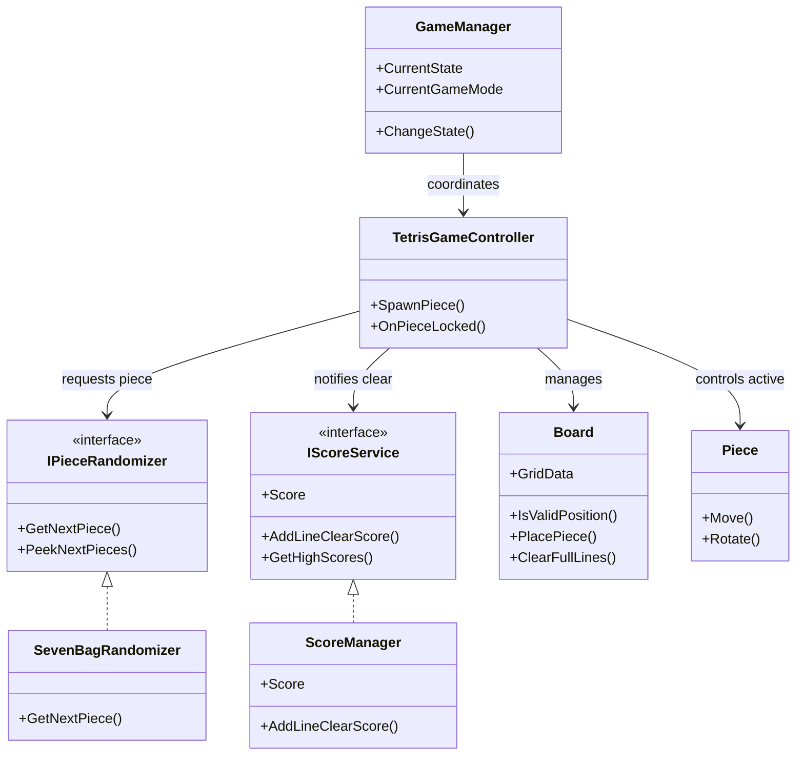

# Kế Hoạch Rebuild Unity Editor & Refactor Toàn Diện Project Tetris

## Mục Tiêu Tổng Thể
1. **Khắc phục triệt để lỗi Editor & Scene:** Sửa lỗi thiếu UI reference gây kẹt màn hình khi ấn Start, dọn dẹp component rác trên `EventSystem`, dựng hoàn chỉnh các màn hình UI còn thiếu.
2. **Tái cấu trúc mã nguồn theo chuẩn SOLID & Clean Code:** Triệt tiêu phụ thuộc vòng tròn giữa `Board` và `Piece`, tách các trách nhiệm ôm đồm (7-Bag, Hold, Scoring, GameMode), cấu hình hóa thông số qua `ScriptableObject`.

---

## Giai Đoạn 1: Ổn Định & Dựng Hoàn Chỉnh Trong Unity Editor (Editor Stabilization)
> **Mục tiêu:** Đảm bảo scene `Tetris.unity` có đầy đủ UI, không còn lỗi dangling reference (`null`), game chạy mượt mà ngay trong Editor.

- [ ] **Task 1.1: Dọn dẹp Component rác trên `EventSystem`**
  - Thao tác: Xóa component `Piece` đang bị gắn nhầm trên GameObject `EventSystem` (InstanceID: `42050`).
  - *Verify:* `EventSystem` chỉ còn 3 component chuẩn: `Transform`, `EventSystem`, `InputSystemUIInputModule`.
- [ ] **Task 1.2: Dựng các UI Panels còn thiếu trên Canvas**
  - Thao tác:
    - Tạo `ModeSelectPanel` (chứa tiêu đề, nút `Marathon`, `Sprint`, `VersusAI`, `OnlineMultiplayer`, và nút `Back`).
    - Tạo `VersusAIPanel` (màn hình chờ AI placeholder, nút `Back`).
    - Tạo `LobbyPanel` (gắn script `OnlineLobbyStub`, input room code, nút Create Room, Join Room, nút `Back`).
  - *Verify:* Cả 3 Panel được xếp ngay ngắn dưới `Canvas`, mặc định `SetActive(false)`.
- [ ] **Task 1.3: Dựng UI Text hiển thị Combo & Back-to-Back**
  - Thao tác: Tạo 2 component `TextMeshProUGUI` (`ComboText` và `BackToBackText`) trên HUD gameplay.
  - *Verify:* Nằm ở vị trí dễ quan sát bên cạnh bảng cờ.
- [ ] **Task 1.4: Nối Inspector References cho `UIManager` trên `GameController`**
  - Thao tác: Kéo thả các reference tương ứng vào `UIManager`:
    - `modeSelectPanel`, `versusAIPanel`, `lobbyPanel`
    - `marathonButton`, `sprintButton`, `versusAIButton`, `onlineMultiplayerButton`, `modeSelectBackButton`
    - `versusAIBackButton`, `lobbyBackButton`
    - `comboText`, `backToBackText`
  - *Verify:* Không còn bất kỳ trường UI nào bị `None (GameObject/Button)` trên `UIManager`.
- [ ] **Task 1.5: Chuẩn hóa cấu hình Active Input Handling**
  - Thao tác: Kiểm tra `ProjectSettings/Player.asset`, đảm bảo `activeInputHandler` được thiết lập tối ưu cho New Input System.
  - *Verify:* Unity Console không còn xuất hiện cảnh báo Input Manager deprecation khi Play.

---

## Giai Đoạn 2: Tách Cấu Hình Dữ Liệu Ra ScriptableObject (OCP - Open/Closed)
> **Mục tiêu:** Loại bỏ hoàn toàn các "Magic Numbers" và công thức hardcode trong C#, giúp cân bằng game dễ dàng qua Inspector.

- [ ] **Task 2.1: Tạo `TetrisGameSettingsSO`**
  - Chuyển các thông số điều khiển & vật lý:
    - `dasDelay`, `arrDelay`, `softDropArrDelay`
    - `lineClearFlashDuration`, `lineClearFlashCount`
    - Công thức / Bảng tính tốc độ rơi theo level
  - *Verify:* Tạo được asset `TetrisGameSettings.asset` trong `Assets/Settings/`.
- [ ] **Task 2.2: Tạo `TetrisScoringSettingsSO`**
  - Chuyển các thông số điểm:
    - Bảng điểm gốc (`BasePoints` 1, 2, 3, 4 dòng)
    - Hệ số nhân Combo (`comboMultiplier`)
    - Hệ số nhân Back-to-Back (`b2bMultiplier`)
  - *Verify:* Tạo được asset `TetrisScoringSettings.asset` trong `Assets/Settings/`.

---

## Giai Đoạn 3: Tái Cấu Trúc Kiến Trúc & SOLID (Architectural Refactoring)
> **Mục tiêu:** Đạt chuẩn Clean Code, triệt tiêu phụ thuộc vòng tròn, tách biệt ranh giới Single Responsibility.

- [ ] **Task 3.1: Tách 7-Bag Randomizer ra khỏi `Board.cs` (SRP & DIP)**
  - Tạo interface `IPieceRandomizer` và implementation `SevenBagRandomizer`.
  - Chuyển `_pieceQueue`, `RefillBag`, `Fisher-Yates shuffle` ra khỏi `Board.cs`.
  - *Verify:* `Board` không còn chứa code bốc thăm hay lưu queue khối.
- [ ] **Task 3.2: Tách cơ chế Hold Piece ra `HoldPieceManager` (SRP)**
  - Tạo `HoldPieceManager.cs` chịu trách nhiệm lưu trạng thái `HoldPieceData`, tilemap preview và cờ `hasUsedHold`.
  - *Verify:* `Board` giảm bớt ~50 dòng code liên quan đến hold.
- [ ] **Task 3.3: Triệt tiêu Circular Dependency giữa `Board` và `Piece`**
  - Loại bỏ việc `Piece` tự gọi `board.SpawnPiece()` trong coroutine của mình.
  - Tạo `TetrisGameController` (hoặc nâng cấp vai trò điều phối vòng lặp lượt chơi):
    - `Piece` chỉ bắn sự kiện `OnPieceLocked`.
    - Bộ điều phối sẽ xử lý: Khóa khối -> Kích hoạt animation xóa dòng -> Báo điểm -> Gọi Spawner sinh khối mới.
  - *Verify:* `Piece` không còn phụ thuộc ngược vào `Board` để điều khiển vòng đời game.
- [ ] **Task 3.4: Tách hệ thống Điểm & Lưu Trữ (Score & Persistence Service)**
  - Tách logic tính điểm Guideline, Combo, B2B ra `ScoreManager` (implement `IScoreService`).
  - Thêm tính năng lưu trữ High Score xuống `PlayerPrefs` hoặc file JSON (thay vì in-memory list bị mất khi tắt game).
  - *Verify:* Thoát game và vào lại, bảng High Score vẫn giữ nguyên kỷ lục cũ.
- [ ] **Task 3.5: Áp dụng Strategy Pattern cho `GameMode` (OCP)**
  - Định nghĩa interface `IGameModeRule`:
    - `MarathonModeRule`: Level up theo số dòng, kết thúc khi chạm trần.
    - `SprintModeRule`: Đếm thời gian xóa đủ 40 dòng (dễ dàng mở rộng sau này).
  - *Verify:* Thêm game mode mới không cần sửa logic cốt lõi của `GameManager`.

---

## Giai Đoạn 4: Chuẩn Hóa Clean Code & Naming Conventions
> **Mục tiêu:** Toàn bộ codebase đạt chuẩn C# Microsoft & Unity Style Guidelines.

- [ ] **Task 4.1: Chuẩn hóa Public Members và Properties sang PascalCase**
  - Sửa `public Board board` ➔ `public Board Board { get; private set; }`
  - Sửa `public Vector3Int[] cells` ➔ `public Vector3Int[] Cells { get; private set; }`
  - Sửa `public Vector3Int position` ➔ `public Vector3Int Position { get; private set; }`
  - Đổi tên method `Piece.Initialized(...)` ➔ `Piece.Initialize(...)`.
- [ ] **Task 4.2: Chuẩn hóa Private Fields với tiền tố gạch dưới `_`**
  - Chuyển `dasTimer`, `arrTimer`, `stepTime`, `lockTime` ➔ `_dasTimer`, `_arrTimer`, `_stepTime`, `_lockTime`.
- [ ] **Task 4.3: Tối ưu bộ nhớ & Tránh GC Allocations**
  - Dùng `System.Text.StringBuilder` cho các hàm tạo chuỗi High Score trong `UIManager`.

---

## Tiêu Chí Hoàn Thành (Done When)
- [ ] Không còn bất kỳ component rác (`Piece` trên `EventSystem`) hay unassigned reference nào trên `UIManager`.
- [ ] Người chơi mở game -> Click Start -> Hiện bảng chọn Mode -> Chọn Marathon -> Vào ván chơi bình thường.
- [ ] Điểm số, Combo text, Back-to-Back text hiển thị chính xác và mượt mà trên UI.
- [ ] Không còn sự phụ thuộc chéo vòng tròn giữa `Board` và `Piece`.
- [ ] Codebase tuân thủ 5 nguyên tắc SOLID, không có magic numbers, đạt chuẩn Clean Code C#.
